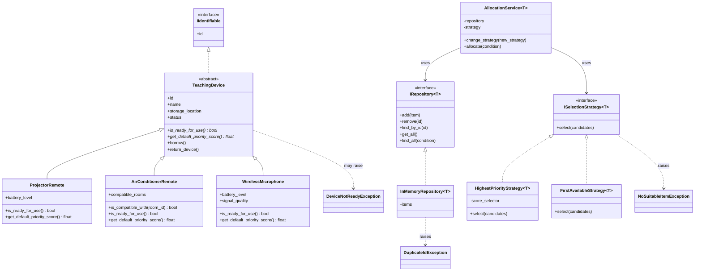

# 2. Danh sach lop va so do quan he

## 2.1. Danh sach lop

| Lop/interface | Trach nhiem chinh |
|---|---|
| `DeviceStatus` | Luu cac trang thai cua thiet bi |
| `IIdentifiable` | Quy dinh doi tuong co ma dinh danh |
| `TeachingDevice` | Lop truu tuong chua thong tin va hanh vi chung cua thiet bi |
| `ProjectorRemote` | Quan ly dieu khien may chieu va muc pin |
| `AirConditionerRemote` | Quan ly dieu khien dieu hoa va cac phong tuong thich |
| `WirelessMicrophone` | Quan ly micro, pin va chat luong tin hieu |
| `IRepository[T]` | Quy dinh cac thao tac luu tru tong quat |
| `InMemoryRepository[T]` | Cai dat kho luu tru trong bo nho |
| `ISelectionStrategy[T]` | Quy dinh cach lua chon doi tuong |
| `HighestPriorityStrategy[T]` | Chon ung vien co diem uu tien cao nhat |
| `FirstAvailableStrategy[T]` | Chon ung vien dau tien |
| `AllocationService[T]` | Phoi hop kho luu tru va chien luoc de cap phat thiet bi |
| `DuplicateIdException` | Bao loi khi ma dinh danh bi trung |
| `NoSuitableItemException` | Bao loi khi khong co ung vien phu hop |
| `DeviceNotReadyException` | Bao loi khi thiet bi khong du dieu kien su dung |

Ten interface duoc giu gan voi tai lieu de de doi chieu. Khi trien khai bang Python, co the su dung `ABC`, `Generic`, `TypeVar` hoac `Protocol` tuy truong hop.

## 2.2. So do lop UML

## 2.3. Giai thich quan he

- `TeachingDevice` thuc thi `IIdentifiable` va la lop co so truu tuong cho ba loai thiet bi.
- Ba lop thiet bi ke thua `TeachingDevice` va cai dat hanh vi san sang, tinh diem uu tien theo cach rieng.
- `InMemoryRepository[T]` cai dat cac thao tac duoc quy dinh boi `IRepository[T]`.
- Hai lop chien luoc cai dat `ISelectionStrategy[T]`.
- `AllocationService[T]` su dung repository va strategy thong qua cac abstraction, khong phu thuoc vao lop chien luoc cu the.

## 2.4. Quyet dinh thiet ke va trade-off

Thiet ke dung lop co so, repository tong quat va chien luoc lua chon giup giam viec lap lai code va de bo sung loai thiet bi moi. Tuy nhien, so luong lop va interface nhieu hon cach viet tat ca trong mot lop. Voi phien ban dau, day la chi phi chap nhan duoc de lam ro cac noi dung ke thua, da hinh va generic trong bai tap.
